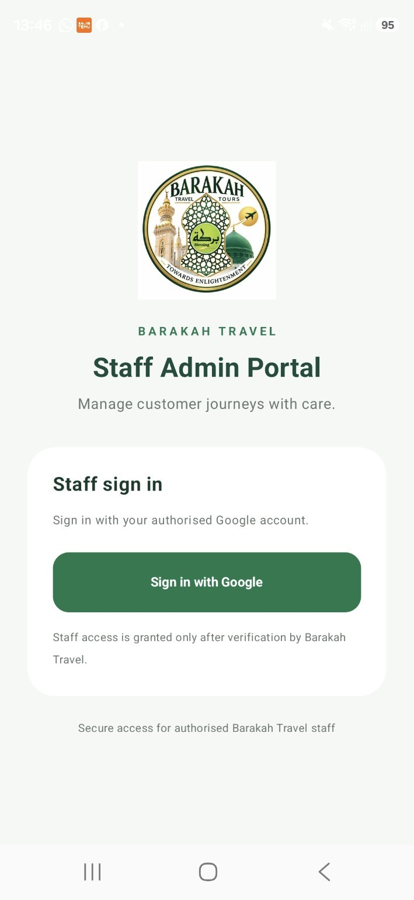
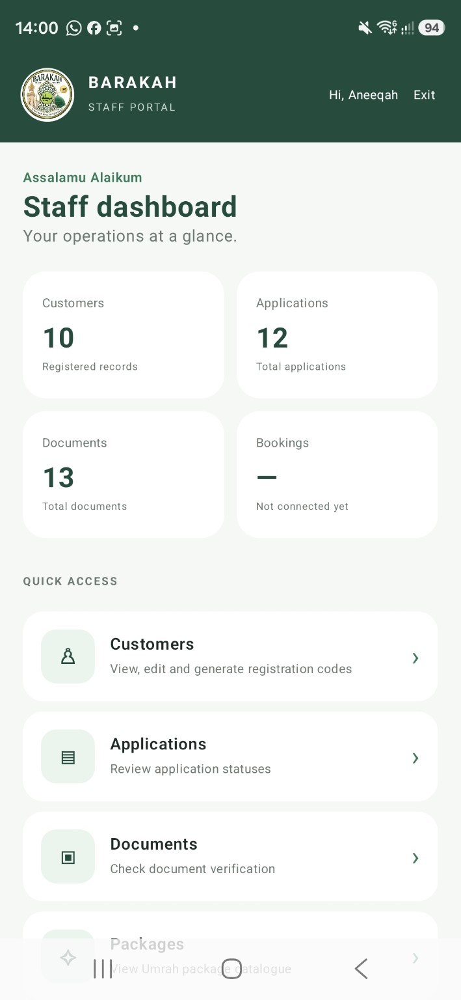
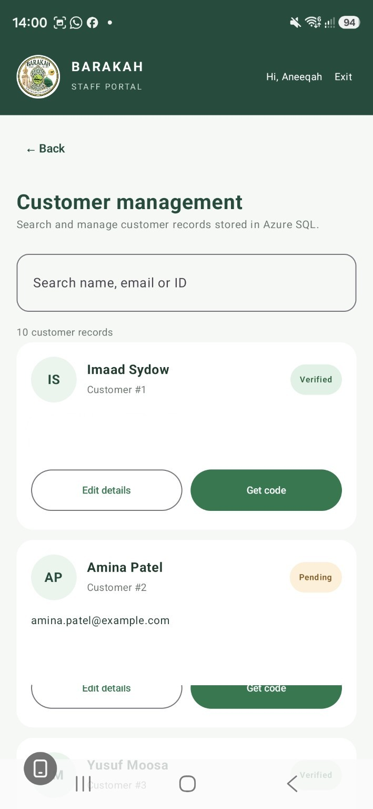
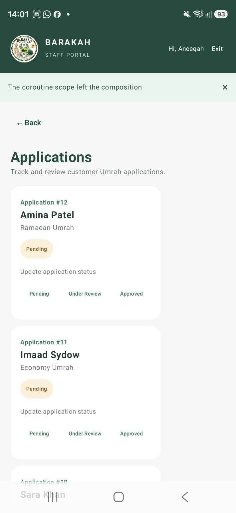
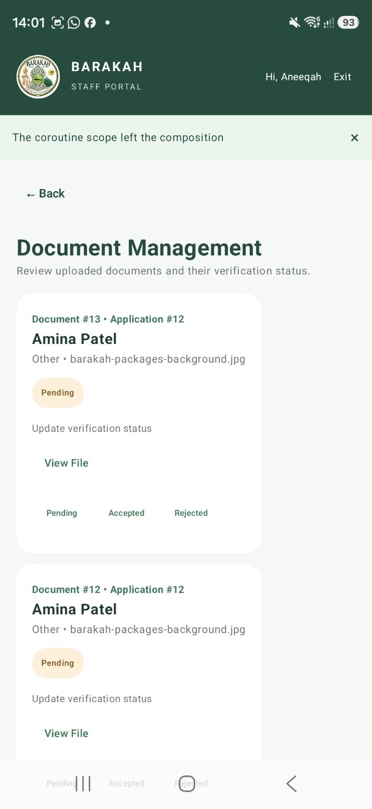
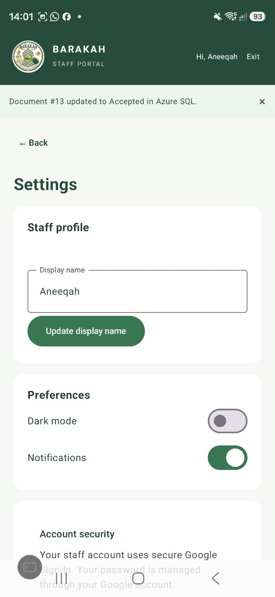

# Barakah Travel & Tours – Integrated Umrah Management System


**Module:** XISD6329 – Work Integrated Learning 3B  
**Team:** Aneeqah Fisher (ST10454674) · Taulha Basardien (ST10457106) · Ingvar Thor Hultkrantz (ST10434704)

## Demonstration video

[](https://youtu.be/G3n2f-ZlwRU)

https://youtu.be/G3n2f-ZlwRU – Android staff app on a physical phone, Google Sign-In, dashboard, customers, applications, documents, settings, and the data stored in Azure SQL.

## Purpose of the system

Barakah Travel & Tours is an Umrah travel provider. Before this project, staff collected customer details and documents by hand and re-typed them. This system replaces that with:

- a **customer website** where registered customers (registered by staff, who issue a *registration code*) complete their details, choose a package, upload documents and track their application;
- an **Android staff app** where authorised staff manage customers, applications and documents;
- one **ASP.NET Core 8 API** and one **Azure SQL database** shared by both, so nothing is entered twice.

**Target users:** pilgrims (customers) and Barakah staff/administrators.

## Design considerations

- **Single source of truth** – website and app use the same API and database.
- **Two authentication models** – staff use Google Sign-In through Firebase; the API verifies the Firebase ID token and checks the user is an active Admin/Staff in the `Users` table. Customers use a registration code plus an email/password account; passwords are stored only as ASP.NET Core Identity hashes.
- **Privacy** – uploaded documents are only reachable by authorised users; the database schema export contains no customer data or passwords.
- **Usability** – clear navigation, input validation (`Validation.kt`, form validation on the website), friendly error messages.
- **Maintainability** – separate folders for app, API, website and database; CI on every push.

## Screenshots

### Android staff app (Samsung Galaxy S26)

| Sign in | Dashboard | Customers |
|---|---|---|
|  |  |  |

| Applications | Documents | Settings |
|---|---|---|
|  |  |  |

### Customer website

| Home | Packages | Register |
|---|---|---|
|  |  |  |

> Add the website screenshots to `docs/images/` using the names above.

### Wireframes
Customer website wireframes are in `docs/images/wireframes/`.

## Repository structure

```
app/                     Android staff app (Kotlin, Jetpack Compose)
  src/main/              application source and resources
  src/test/              unit tests (ValidationTest.kt)
BarakahTravel.API/       ASP.NET Core 8 Web API
BarakahTravel.Website/   Razor Pages customer website
database/                schema export (.dacpac), README, seed_customer_accounts.sql
prototype/               Task 1 HTML/CSS/JS staff-portal prototype
docs/                    screenshots, wireframes and the Staff App User Guide (PDF)
.github/workflows/       GitHub Actions workflow (android-ci.yml)
```

## Technologies

| Component | Technology |
|---|---|
| Android app | Kotlin, Jetpack Compose, Retrofit, DataStore |
| Authentication | Firebase Authentication, Google Sign-In (staff); ASP.NET Core Identity password hashing (customers) |
| API | C#, ASP.NET Core 8, Entity Framework Core |
| Website | ASP.NET Core Razor Pages, HTML, CSS, JavaScript, Bootstrap |
| Database | Microsoft Azure SQL Database (11 tables) |
| Source control / CI | Git, GitHub, GitHub Actions, Azure DevOps / Azure Boards |

## Setup

### Android app
1. Clone the repo and open it in Android Studio; let Gradle sync.
2. Put your Firebase `google-services.json` in `app/` (never commit it).
3. Set the API address in `app/build.gradle.kts` (`API_BASE_URL` for debug; `API_BASE_URL_RELEASE` in `gradle.properties` for release).
4. Run on a physical Android device.

### API
1. Open `BarakahTravel.API.sln` in Visual Studio with the .NET 8 SDK. In Development the API opens Swagger UI, which lists and lets you test every endpoint.
2. Set the `DefaultConnection` connection string (user secrets / environment variable – not in source control).
3. Run the API.

### Website
1. Open `BarakahTravel.Website` in Visual Studio, set the API base address in configuration, and run.

### Database
Use `database/BarakahTravelD_Schema.dacpac` to create the schema. Optional test data: `database/seed_customer_accounts.sql` adds nine simulated customer accounts (hashed passwords).

## GitHub and GitHub Actions

`.github/workflows/android-ci.yml` runs on every push and pull request to `main` and can be started manually. Steps: checkout → Java 17 → restore Firebase config from the `GOOGLE_SERVICES_JSON` secret → `./gradlew :app:testDebugUnitTest` → `./gradlew :app:assembleDebug`.

```bash
./gradlew :app:testDebugUnitTest --no-daemon   # unit tests
./gradlew :app:assembleDebug --no-daemon       # debug APK
```

## Automated tests

`app/src/test/java/com/barakahtravel/staff/ValidationTest.kt` – 25 JUnit tests covering email, password, phone, name and registration-code validation (valid, invalid and boundary cases). More API and repository tests are listed under *Future improvements*.

## Publishing (Google Play)

1. Create a keystore (Android Studio → Build → Generate Signed Bundle/APK, or `keytool`). Keep it out of the repo.
2. Provide `KEYSTORE_PATH`, `KEYSTORE_PASSWORD`, `KEY_ALIAS`, `KEY_PASSWORD` as environment variables or in your local `gradle.properties`.
3. Set `API_BASE_URL_RELEASE` to the hosted HTTPS API.
4. Build: `./gradlew :app:bundleRelease` (or `assembleRelease`), then upload the `.aab` in the Google Play Console.

## Release notes

### v1.1 – final submission
- **New:** customers can now upload an *unabridged birth certificate* (under 18) and *two passport photos* – added to the website upload form and API validation.
- **New:** release signing configuration and a separate release API address for Play Store builds; version bumped to 1.1 (versionCode 2).
- **New:** automated unit tests (`ValidationTest.kt`) now run in GitHub Actions.
- **New:** `seed_customer_accounts.sql` brings `CustomerAccounts` to at least ten records.
- **Fixed:** the notice “The coroutine scope left the composition” no longer appears when moving between screens – cancelled coroutines are now rethrown instead of being shown as errors (`MainActivity.kt`).
- **Improved:** repository root cleaned (duplicate Kotlin files removed, Task 1 prototype moved to `prototype/`).
- **Improved:** README rewritten with purpose, design, setup, CI and publishing guidance.

### Features of this version
- **Google Single Sign-On for staff** with server-side Firebase token verification and an active-staff check.
- **Live dashboard** with customer, application and document counts from the API.
- **In-app document review** (view, verify, reject/request again).
- **Registration-code onboarding** that links staff-created customer records to the customer website account.

### v1.0 – Task 2 prototype
Android staff app (sign-in, dashboard, customers, applications, documents, settings), ASP.NET Core API, Razor Pages website, Azure SQL schema, first CI workflow.

## Known limitations / future improvements
- Packages, bookings, payments and travel schedules are not yet fully integrated in the Android app.
- The customer website uses code + password login; Google sign-in for customers is planned.
- Add API and repository tests to the workflow.
- Move development data-protection keys and tunnel URL to configuration/hosting.

## User documentation
See [`docs/Barakah_Travel_Staff_App_User_Guide.pdf`](docs/Barakah_Travel_Staff_App_User_Guide.pdf) – an 8-page guide with screenshots of every staff screen.
